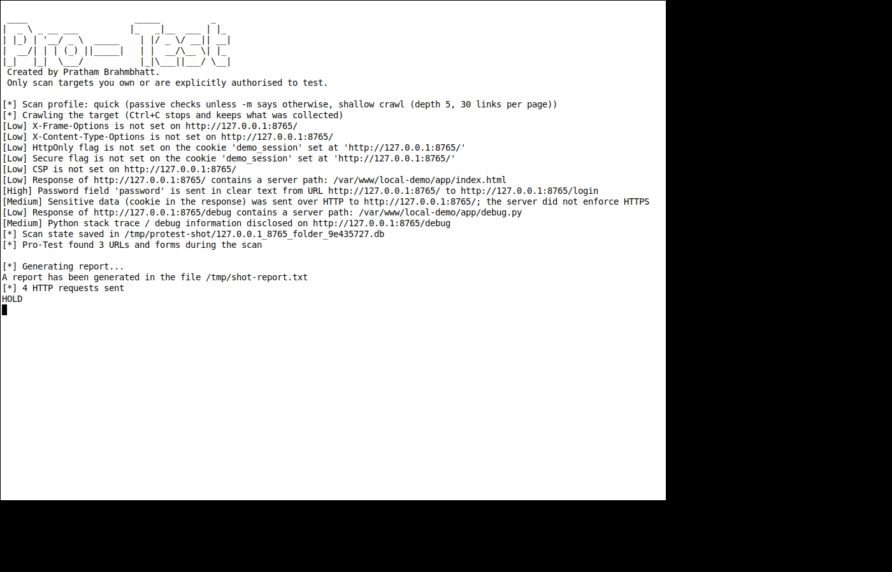
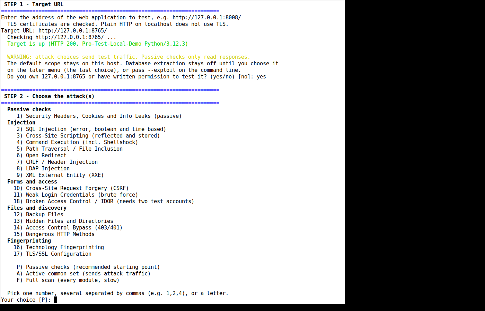
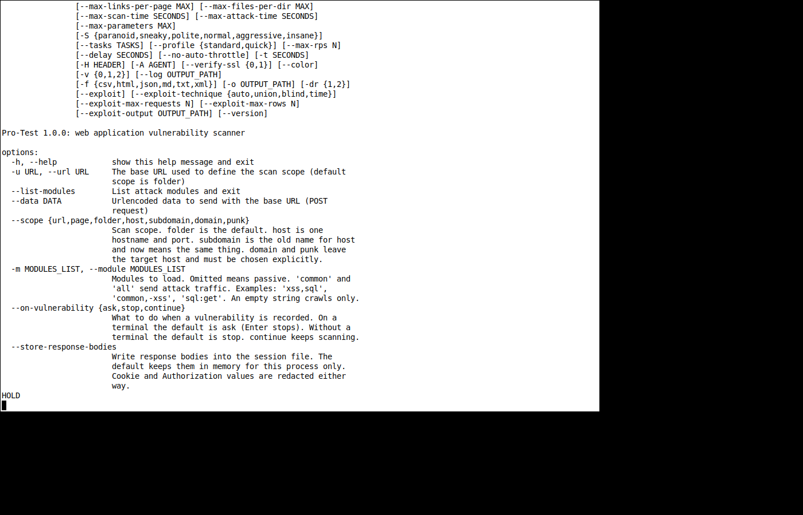

# Pro-Test

Pro-Test is a web application vulnerability scanner written in Python. It crawls a site, reads each response, optionally sends active checks, and writes a report. The command-line entry point is `pro-test`, which calls `protest.app.cli:main`. With no arguments it opens a numbered interactive menu. There is no curses interface. A smaller teaching program, `pro-test-msc`, lives in [msc-edition/](msc-edition/) and does not import this scanner.

Author - **Pratham Brahmbhatt**.

**Only scan an application you own or have written permission to test.** The verified walkthrough below uses the localhost fixture in `examples/local-demo/` and the passive checks only (`-m passive`). Read [SECURITY.md](SECURITY.md) before any other use.

Pro-Test is free software under the GNU General Public License, version 2 or any later version (GPL-2.0-or-later). The full text is [LICENSE](LICENSE). Copyright in the original portions stays with Pratham Brahmbhatt. [NOTICE](NOTICE) records the sqlmap and Wapiti notices for the detection data and the shared lines. That grant is not permission to scan a system you do not own.

## Authorisation and explicit opt-in

The tool's purpose is an authorised assessment: crawl, passive checks, and the active modules in `protest/active/`. Omitting `-m` loads `passive` only. The active set is explicit: `-m common` or `-m all`, or the menu presets `A` and `F`. `common` still includes `exec`, `file`, `sql`, `xss`, `permanentxss`, `redirect`, and `ssl`, plus the passive checks. That set sends attack traffic and still requires permission.

These actions are off unless you ask for them. Each one prints a warning or sits behind its own flag:

| Action | How you turn it on | What it does |
|---|---|---|
| Database extraction | `--exploit`, or choice 8 on the "What next?" menu | Reads tables and rows through a confirmed SQL injection. Account-like tables are read first. |
| Leave the target host | `--scope domain` | Other host names on the same registered domain. |
| Follow links to any site | `--scope punk` | No host limit. Every host reached needs its own authorisation. |
| Skip TLS checks | `--verify-ssl 0` | Accepts any certificate. Meant for a localhost lab whose certificate you created. |

The default scope is `folder`: the crawl stays on the same scheme, hostname and port, under the base URL's directory. `url`, `page`, and `host` use that same origin. `subdomain` is the old name for `host` and now means the same hostname and port, not every port. Nothing in the default path switches the scope to `domain` or `punk`. `domain` uses a curated suffix list and does not guess the last two labels when the suffix is unknown.

TLS certificate verification is on by default in the command line and in the menu. Plain HTTP, including the localhost demo, does not use a certificate. The menu asks before it will turn verification off, and only after a certificate check has failed or you open Custom settings.

No phone-home request, persistence mechanism, or hardcoded customer target was found. A previous form-filler address on `mailinator.com` is now `user@example.com`. Passwords stored in the history database are encrypted with Fernet from the `cryptography` package. Tokens that start with `pt1:` were written by the previous construction. They are left in the database and are not decrypted; enter the secret again if you still need it.

## Prerequisites

- Python 3.11 or newer. The checks in this repository were run with CPython 3.12.3.
- `git`, and `pipx` for a normal install. On Debian, Ubuntu, or Kali: `sudo apt install python3 python3-pip python3-venv pipx git`, then `pipx ensurepath`. Open a new terminal so `~/.local/bin` is on `PATH`.
- The `cryptography` package. `pipx` installs it inside Pro-Test's private environment. You do not activate that environment, and you do not install it into the system Python.

`pipx` is the install to use. It puts `pro-test` on your PATH. A root install writes the command to `/root/.local/bin`, which a normal account does not see. Install as the account you scan with. There is no `.deb` and no apt repository for this project.

## Install

`pipx install .` installs the directory that contains `pyproject.toml`. Run it from the repository root, not from your home directory.

```bash
git clone https://github.com/pro4501/pro-test.git
cd pro-test
pipx install .
```

Open a new terminal if this one was already open before `pipx ensurepath`. Then, from any directory:

```bash
pro-test --version
pro-test --help
```

The clone needs network access to GitHub. `pipx` needs network access to fetch `cryptography` and `setuptools`. You can skip the checkout with `pipx install git+https://github.com/pro4501/pro-test.git`.

A later checkout is installed again with `pipx install --force .` from the repository root. `pipx upgrade pro-test` only upgrades a copy that was installed from a package index. Remove the command with `pipx uninstall pro-test`.

### Windows PowerShell

```powershell
git clone https://github.com/pro4501/pro-test.git
cd pro-test
py -3.11 -m pip install --user pipx
py -3.11 -m pipx ensurepath
py -3.11 -m pipx install .
```

Open a new PowerShell window, then run `pro-test --version`.

### Working on the source

The virtual environment below is for editing this repository. It is not required once `pipx` has installed the command.

```bash
python3 -m venv .venv
source .venv/bin/activate
python -m pip install -e .
```

`python -m protest` from the repository root runs the same program without an install, because Python puts the current directory on the module path.

## Verified quickstart (localhost only)

The fixture listens on `127.0.0.1` only. It is intentionally missing ordinary browser protections. It does not run commands, read files, query a database, or echo parameters. Do not deploy it.

Terminal 1:

```bash
python examples/local-demo/server.py 8765
```

Terminal 2, from any directory after `pipx install`:

```bash
pro-test -u http://127.0.0.1:8765/ -m passive --profile quick --no-database \
  --store-session /tmp/protest-demo-sessions --flush-session \
  --on-vulnerability continue \
  -f txt -o examples/local-demo/output/report.txt
```

`--on-vulnerability continue` is required for this full passive report when the shell is not interactive. Without it, a non-interactive run stops at the first vulnerability and still writes the report for what it has already seen.

The files in `examples/local-demo/output/` come from that command, once per format, against the fixture on 6 Nov 2026. The terminal screenshot is an xterm capture of the same command with `--color`. The wording matches. The screenshot's last line was printed by the capture shell after Pro-Test exited. None of these runs used an active module or `--exploit`.

Expected console result: 3 resources, 4 HTTP requests, and the passive findings below. Counts from the saved text report:

| Finding | Count |
|---|---|
| Cleartext Submission of Password | 1 |
| Unencrypted Channels | 1 |
| Clickjacking Protection | 1 |
| MIME Type Confusion | 1 |
| HttpOnly Flag cookie | 1 |
| Secure Flag cookie | 1 |
| Content Security Policy Configuration | 1 |
| Information Disclosure - Full Path | 2 |
| Stack Trace Disclosure | 1 |

Attack categories in the same report (SQL injection, cross-site scripting, command execution, path traversal, and the rest) are 0. The report still prints the tool's built-in catalogue, with those counts at zero.



Stop the fixture with Ctrl+C in terminal 1. Delete `/tmp/protest-demo-sessions` when you are done. Details, the menu capture, and the other files are in [examples/local-demo/README.md](examples/local-demo/README.md).

## Command line

`pro-test --help` lists every flag. `pro-test --version` prints `Pro-Test 1.0.0`. `pro-test --list-modules` prints each module's own one-line description and exits. A copy of that help text, with this machine's home directory written as `~`, is in `examples/local-demo/output/help.txt`.

`--menu` is handled before argument parsing, so it does not appear in `--help`. `pro-test` and `python -m protest` with an empty argument list open the same menu.

One of `-u URL` or `--list-modules` is required for a non-menu run. The URL needs an `http://` or `https://` scheme.

| Exit code | When |
|---|---|
| 0 | The scan finished and a report was written, or `--list-modules` / `--version` / `--help` ran. |
| 1 | HTTP authentication failed, or the crawl retrieved no page (the target refused the connection or the URL did not answer). |
| 2 | The arguments are inconsistent or the URL has no `http`/`https` scheme. |
| 130 | Ctrl+C. The crawl does not continue into the attack, and an attack in progress stops. The report is written from what was already stored. |

### Target, scope, and crawl

| Option | Role |
|---|---|
| `-u`, `--url` | Base URL. Default scope is `folder`. |
| `--data` | URL-encoded body. Sends the base URL as POST. |
| `--scope` | `url`, `page`, `folder` (default), and `host` stay on the same scheme, hostname and port. `subdomain` is accepted and means `host`. `domain` and `punk` are explicit off-host modes and print a warning. |
| `-s`, `--start` | Extra start URL, or a file of URLs. Repeatable. |
| `-x`, `--exclude` | URL or wildcard to skip. Repeatable. |
| `-d`, `--depth` | Crawl depth. Default 40. |
| `--max-links-per-page` | Default 100. |
| `--max-files-per-dir` | Default 0, meaning no cap. |
| `--max-scan-time` | Crawl time limit in seconds. |
| `-S`, `--scan-force` | `paranoid`, `sneaky`, `polite`, `normal` (default), `aggressive`, `insane`. These change how many similar query-string URLs are crawled. `insane` disables that cap. |
| `--profile` | `standard` (default) or `quick` (depth 5 and 30 links per page, only where you left the default). There is no `safe` profile. |

### Modules and traffic

| Option | Role |
|---|---|
| `-m`, `--module` | Omitted means `passive`. `common` and `all` are explicit and send attack traffic. Also a comma-separated list, removals such as `common,-xss`, or method limits such as `sql:get`. An empty string crawls and does not run modules. |
| `--on-vulnerability` | `ask` (default on a terminal; Enter stops), `stop` (default when stdin is not a terminal), or `continue`. A repeated finding for the same category, host and parameter does not ask again. |
| `--store-response-bodies` | Write response bodies into the session file. The default keeps them in memory for this process only. Cookie and Authorization values are redacted either way. |
| `-l`, `--level` | `1` (default) or `2`. Level 2 also sends checks in the raw query string. |
| `--skip` | Parameter name to leave alone. Repeatable. |
| `-r`, `--remove` | Drop this parameter from URLs. Repeatable. |
| `--max-parameters` | Skip resources with more inputs than this. |
| `--max-attack-time` | Per-module time limit in seconds. |
| `--tasks` | Concurrent threads. Default 8. |
| `-t`, `--timeout` | Request timeout. Default 10 seconds. |
| `--max-rps`, `--delay` | Request rate. `0` means no limit. |
| `--no-auto-throttle` | Keep the current rate when the server returns 429 or 503. |
| `-H`, `-A` | Extra header, or User-Agent. |
| `-p`, `--proxy` | HTTP or HTTPS proxy URL. |
| `--verify-ssl` | `1` (default) checks TLS certificates. `0` skips the check, prints a warning, and is for a localhost lab whose certificate you created. |
| `--color` | ANSI colours. Off unless you pass this flag. |
| `-v`, `--verbose` | `0` quiet, `1` print each attacked URL, `2` print every request. |
| `--log` | Append a log file. |

Omitting `-m` loads `passive`. Those checks read the response the crawler already fetched. `-m common` adds the active modules `exec`, `file`, `sql`, `xss`, `permanentxss`, `redirect`, and `ssl`. When a vulnerability is recorded, the default on a terminal is to ask; Enter and end-of-file stop. A request already in flight can finish. The next request is not sent. `--on-vulnerability continue` is how a script keeps scanning.

### Authentication and sessions

| Option | Role |
|---|---|
| `--auth-user`, `--auth-password`, `--auth-method` | HTTP Basic or Digest. The user and password are required together. |
| `--form-url`, `--form-user`, `--form-password` | Submit one login form before the crawl. |
| `--form-data`, `--form-enctype` | Raw login body instead of the username and password fields. |
| `--compare-form-user`, `--compare-form-password`, `--compare-cookie`, `--identity-marker` | Second identity for the `access_control` module. |
| `-c`, `--cookie` | JSON cookie file. |
| `-C`, `--cookie-value` | Cookie header sent on every request. |
| `--jwt` | Sent as `Authorization: Bearer`. |
| `--drop-set-cookie` | Ignore `Set-Cookie` on responses. |
| `--skip-crawl`, `--resume-crawl`, `--flush-attacks`, `--flush-session` | Reuse or clear the per-target session database. |
| `--store-session` | Directory for those session files. Default `~/.pro-test/scans/`. |
| `--database`, `--no-database` | Central history database. Default `~/.pro-test/protest.db`. |

### Reports and the extraction flags

| Option | Role |
|---|---|
| `-f`, `--format` | `html`, `json`, `txt`, `csv`, `md`, or `xml`. Default `html`. |
| `-o`, `--output` | File or directory. |
| `-dr`, `--detailed-report` | `1` adds the crawled URL list. `2` also stores response bodies for findings. |
| `--exploit` and `--exploit-technique`, `--exploit-max-requests`, `--exploit-max-rows`, `--exploit-output` | Opt-in database extraction after a confirmed SQL injection. Off unless you pass `--exploit`. Not used for the sample reports. |

HTML reports with no `-o` go to `~/.pro-test/generated_report/`. Other formats with no `-o` are written in the current directory, with a name based on the host and the time.

## Interactive menu

`python -m protest` or `pro-test --menu` asks for a URL, checks that it answers, then asks you to confirm that you own that host or have written permission. The default answer is no.

It then lists numbered checks. The labels and numbers are fixed in `protest/app/menu.py`:

| Choice | What it passes to the scanner |
|---|---|
| 1 | `passive` |
| 2 | `sql,timesql` |
| 3 | `xss,permanentxss` |
| 4 | `exec,shellshock` |
| 5 | `file` |
| 6 | `redirect` |
| 7 | `crlf` |
| 8 | `ldap` |
| 9 | `xxe` |
| 10 | `csrf` |
| 11 | `brute_login_form` |
| 12 | `backup` |
| 13 | `buster` |
| 14 | `htaccess` |
| 15 | `methods` |
| 16 | `wapp` |
| 17 | `ssl` |
| 18 | `access_control` (asks for two test accounts) |
| P | `passive` (the suggested start) |
| A | `common` (sends attack traffic) |
| F | `all` |

Settings are `1` standard (depth 40), `2` quick crawl (depth 5; this does not choose modules), or `3` custom (scope, depth, timeout, threads, attack level, rate, cookie). The menu capture used URL `http://127.0.0.1:8765/`, confirmation `yes`, choice `P`, settings `2`. Choice 8 on the later "What next?" menu is database extraction and was not selected. Enter on a sub-prompt goes back. Enter on "What next?" does not exit; type `0` to leave.



After a scan the menu offers:

| Choice | Action |
|---|---|
| 1 | Finding detail, including the stored request |
| 2 | Send the stored check again and print whether it still reproduces |
| 3 | Write a report in any supported format |
| 4 | Print informational results as well as weaknesses |
| 5 | Another module set against the same URL |
| 6 | A new URL |
| 7 | History, parameters, and stored credentials in the central database |
| 8 | Database extraction. Not part of the demo. |
| 0 | Exit |

The menu always records the run in `~/.pro-test/` (session plus the central database). The command-line quickstart passes `--no-database` and `--store-session` so that history stays in the directory you name.

## Modules

Passive modules only read the response already fetched by the crawler. Active modules send further requests. "Yes" in the Default column means the module runs when `-m` is omitted.

| Module | Default | What it reports |
|---|---|---|
| `http_headers` | yes | Missing or weak `X-Frame-Options`, `X-Content-Type-Options`, HSTS |
| `cookieflags` | yes | Cookie without `HttpOnly` or `Secure` |
| `csp` | yes | Missing or permissive Content-Security-Policy |
| `information_disclosure` | yes | Filesystem paths in a response |
| `stacktrace_disclosure` | yes | Stack traces and debug pages |
| `unsecure_password` | yes | A password field posted over HTTP |
| `https_redirect` | yes | HTTP used for cookies, parameters, or POST bodies |
| `inconsistent_redirection` | yes | A redirect whose body still contains links or forms |
| `xss` | | Reflected script or HTML injection. In `-m common`. |
| `permanentxss` | | A marker from `xss` showing up on another page. In `-m common`. |
| `sql` | | Error-based and boolean SQL injection. In `-m common`. |
| `timesql` | | Time-based SQL injection |
| `exec` | | Command or code execution. In `-m common`. |
| `file` | | Path traversal and file inclusion. In `-m common`. |
| `redirect` | | Open redirect. In `-m common`. |
| `ssl` | | Certificate and legacy TLS issues on HTTPS. In `-m common`. |
| `crlf` | | Header injection |
| `ldap` | | LDAP error after a test value |
| `xxe` | | In-band XML external entities |
| `shellshock` | | CVE-2014-6271 on CGI |
| `csrf` | | Form without a checked anti-forgery token |
| `brute_login_form` | | A short built-in list of common logins |
| `backup` | | Backup filenames, and secret-like lines inside them |
| `buster` | | Unlinked paths from a built-in word list |
| `htaccess` | | A 401 or 403 that answers a custom method |
| `methods` | | Unexpected HTTP methods |
| `access_control` | | A page from user A readable by user B or with no session |
| `wapp` | | Technology fingerprint |

`access_control` needs the compare-user options or the menu prompts. It replays GET pages. It does not submit those forms again.

## Configuration and runtime storage

There is no configuration file and no `PROTEST_*` environment variable. Behaviour comes from the command line and, for the menu, from the answers you type. `~` is the home directory of the user running the process.

| Path | Contents |
|---|---|
| `~/.pro-test/protest.db` | Every scan, parameter, finding, and credential row. Usernames are plain text. |
| `~/.pro-test/protest.key` | 32-byte key for the password and token column. Created with mode `0600`. Fernet keys are derived from it. |
| `~/.pro-test/scans/` | One SQLite file per target and scope. |
| `~/.pro-test/menu_sessions/` | Sessions started from the menu. |
| `~/.pro-test/generated_report/` | Default HTML reports. |
| `~/.pro-test/extracted/` | JSON from database extraction. |

A found password is stored only in the encrypted credential table; copies inside finding text are replaced with `******`. Data read by the extraction step is not copied into `protest.db`. Anyone who has both the database and the key can decrypt the column. Keep the key off shared disks and out of git. `.gitignore` excludes these paths.

Session files are named from the host, the scope, and a short hash of the base URL, for example `127.0.0.1_8765_folder_9e435727.db`. On Unix the directory is mode `0700` and the file is mode `0600`. Response bodies are not in that file unless you passed `--store-response-bodies`. The same process still has the bodies in memory, so the attack phase of that run can read them. A later process does not. Cookie, Set-Cookie, Authorization, Proxy-Authorization and `X-Api-Key` values are stored as `[redacted]`.

## Output formats

Every generator writes the same finding fields: severity, confidence, URL, parameter, the value that was sent, the evidence, the raw request, and a `curl` command for that request. Confidence is `Confirmed`, `Probable`, or `Possible`. Passive findings are observations of the response and are marked `Confirmed`.

The sample files are **LOCAL DEMO / EXAMPLE** output from `http://127.0.0.1:8765/` on 6 Nov 2026:

- [examples/local-demo/output/report.txt](examples/local-demo/output/report.txt)
- [examples/local-demo/output/report.json](examples/local-demo/output/report.json)
- [examples/local-demo/output/report.md](examples/local-demo/output/report.md)
- [examples/local-demo/output/report.html](examples/local-demo/output/report.html)
- [examples/local-demo/output/report.csv](examples/local-demo/output/report.csv)
- [examples/local-demo/output/report.xml](examples/local-demo/output/report.xml)
- [examples/local-demo/output/scan-terminal.txt](examples/local-demo/output/scan-terminal.txt)

## Limitations

- The crawler understands HTML links and forms with the standard library. It does not run JavaScript, drive a browser, import OpenAPI, or speak NTLM, SOCKS, or Tor.
- There is no out-of-band callback server. Cross-site scripting checks use a `pro-test.invalid` hostname, which is not a host this program contacts.
- TLS certificates are checked unless you pass `--verify-ssl 0`. A localhost lab with a certificate you created is the case that flag is for. Plain HTTP is unchanged.
- Credential tokens are Fernet (`pt2:`). A `pt1:` token is rejected and left in the database. Anyone with both the database and `protest.key` can still decrypt new tokens. `cryptography` is Apache-2.0 or BSD-3-Clause; shipping it with this GPL-2.0-or-later program is commonly done under GPL-3. That sentence is not a legal opinion. See [NOTICE](NOTICE).
- `domain` uses the suffix list in `protest/net/scope.py`. It is not the Public Suffix List. An unknown suffix does not pull in neighbouring hostnames. `punk` is still any http or https URL, and it does not follow `file:` or other schemes. Cookie and Authorization headers are not sent to a different origin.
- While a vulnerability prompt is open, a request that has already been sent can finish. The client refuses the next one after Stop.
- A target that refuses the connection exits 1 and does not write a report. A target that answers, even with an empty or error page, still exits 0.
- The author's notes refer to a fictional practice site and a sibling `Test-Server/university_site.py`. That server is not in this tree. Rebuilding it here would mean standing up the old multi-issue lab, so the 11 tests that import it stay skipped. They are not passes. Database extraction was not run against that missing server or against the passive localhost fixture (the fixture has nothing to extract).
- The menu is a sequence of prompts. Piped input works; colours follow whether stdout is a terminal.

Differences the author recorded relative to Wapiti (headless browsing, an intercepting proxy, Swagger import, NTLM, browser cookie import, out-of-band modules, and modules built on large external databases) are described in [docs/wapiti-analysis.md](docs/wapiti-analysis.md). [docs/CODE_GUIDE.md](docs/CODE_GUIDE.md) is the author's map of the source.

## Troubleshooting

| What you see | What it means |
|---|---|
| `Directory '.' is not installable` | `pipx install .` or `pip install .` did not run in the repository root. `cd pro-test` (the folder that contains `pyproject.toml`) and run it again. |
| `pro-test: command not found` | The shell was started before `pipx ensurepath`, or the command was installed as root into `/root/.local/bin`. Open a new terminal as the same user. Do not activate a virtual environment for a normal run. `python -m protest --help` from the repository root still works. |
| `No module named protest` | The current directory is not the repository and the package is not installed. |
| `invalid choice: 'safe'` | The only profiles are `standard` and `quick`. |
| `Invalid base URL` and exit 2 | Include `http://` or `https://`. |
| `No page could be retrieved` and exit 1 | Nothing accepted the connection. Start the fixture, or check the host and port. |
| `TLS certificate verification is off` | You passed `--verify-ssl 0`. Turn it back on for any host whose certificate you did not create. |
| `certificate verify failed` | The default check rejected the certificate. For a localhost lab you control, pass `--verify-ssl 0` or accept the menu prompt. |
| `HTTP authentication failed` and exit 1 | The server answered 4xx to the Basic or Digest credentials. |
| A second run seems to skip the crawl | A session file already exists. Pass `--flush-session` or `--resume-crawl`. |
| The menu says the scan was cancelled | The permission question defaults to no. Answer `yes` only for a host you are allowed to test. |
| Reports or `protest.db` appeared in your home directory | The menu, or a CLI run without `--no-database`, writes `~/.pro-test/`. |
| `This secret was stored as pt1:` | The row was written by the old construction. It is still in the database and was not decrypted. Enter the password or token again. |
| The scan stops after the first finding | Stdin is not a terminal, so the default is stop. Pass `--on-vulnerability continue` to keep scanning. Enter at the prompt also stops. |

## Tests and development

From the repository root:

```bash
python3 -m venv .venv
source .venv/bin/activate
python -m pip install -e .
python -m unittest tests.test_units tests.test_local_demo tests.test_cli_smoke tests.test_end_to_end tests.test_safety -v
cd msc-edition && python -m unittest tests.test_edition -v
```

The full-tool command collects 45 tests. 11 are skipped and 34 are executed. On the run recorded with this change, all 34 executed tests passed. The 11 skips are not passes: they are the end-to-end and access-control cases in `tests/test_end_to_end.py`, which import `university_site`. That legacy practice server is not in this tree, and it was not replaced with a stand-in that pretends those cases ran. The MSc edition command collects 7 tests, skips none, and those 7 passed on the same run.

`tests/test_exploit_step5.py` drives database extraction against an in-process stand-in. It was not executed for this release. `python -m unittest discover -s tests -t .` collects that module as well; use the command above for the release checks. The coverage gap is those 11 skipped cases plus the unrun extraction test.

GitHub Actions runs that same command, on Python 3.11 and 3.12, in `.github/workflows/tests.yml`. The workflow does not discover tests, does not run extraction, and does not contact a host other than what those modules already use (the localhost fixture and a closed `127.0.0.1` port).

`tests/test_units.py` covers requests, the crawler mutator, scope, module-name parsing, the credential vault, and the local XSS context checker. `tests/test_safety.py` covers origin-bound credentials, redirects, the pause, and file modes, all on `127.0.0.1`. `tests/test_local_demo.py` checks that the fixture stays on `127.0.0.1` and does not reflect input. `tests/test_cli_smoke.py` checks exit codes 2 and 1 for a bad URL and a closed port.

An editable install (`pip install -e .`) keeps the console script pointed at this checkout. Packaging was also checked with a normal `pip install` of this directory into a fresh virtual environment: the wheel builds, `pro-test --version` prints `Pro-Test 1.0.0`, and `pro-test --help` exits 0 from another working directory.

Layout:

```
protest/     full scanner package (command: pro-test)
  app/       cli.py and menu.py
  core/      crawler, scheduler, session, findings, pause, redaction, vault
  net/       HTTP client, scope, login helpers
  parsing/   HTML links and forms
  active/    active modules
  passive/   response checks
  reporting/ report writers, live re-check, database extraction
msc-edition/ separate teaching package (command: pro-test-msc)
tests/       unittest modules for the full scanner
examples/local-demo/   localhost fixture and LOCAL DEMO / EXAMPLE output
docs/        author's code guide and Wapiti notes
LICENSE      GNU GPL version 2 (the program is version 2 or later)
NOTICE       copyright and provenance for sqlmap and Wapiti material
```

## Educational edition

`msc-edition/` is a second program. It does not import `protest`. Install it from that directory with `pipx install .`. The command is `pro-test-msc`. Its README is the code map, the request-to-finding walkthrough, and the differences from this scanner. `msc-edition/VIVA.md` is a study guide. It does not claim a mark.

## Licence and provenance

Pro-Test is released under the GNU General Public License, version 2 or any later version. [LICENSE](LICENSE) is the GPL version 2 text. The "or later" election matches the notices on the copied material: sqlmap's LICENSE says "Version 2 (or later)", and Wapiti's source-file headers say "either version 2 of the License, or (at your option) any later version." Package metadata uses the SPDX identifier `GPL-2.0-or-later` (`license` in `pyproject.toml`). Current setuptools rejects that expression together with the older "GPLv2+" trove classifier, so the classifier is not set. The SPDX field is the machine-readable statement.

Copyright in the original portions belongs to Pratham Brahmbhatt. [NOTICE](NOTICE) keeps the upstream copyright lines. In short: 48 of the 64 DBMS error expressions in `protest/active/mod_sql.py` match sqlmap `data/xml/errors.xml` at tag 1.4, including the combined MySQL/MariaDB "check the manual" pattern (sqlmap copyright 2006-2020 Bernardo Damele Assumpcao Guimaraes and Miroslav Stampar). `GENERIC_PATTERNS` in that module, and a block of lines in `protest/active/base.py` and `protest/core/crawler.py`, match Wapiti source fetched from master on 2026-11-06 (copyright Nicolas Surribas and Cyberwatch). No Wapiti or sqlmap tree is vendored. `docs/wapiti-analysis.md` is the author's notes, not Wapiti's manual.

Wapiti's README and PyPI classifier say "GPL version 2" without repeating "or later", while its source headers include "or later". NOTICE follows the source headers and sqlmap's wording. That is a reading of the notices, not a legal opinion. sqlmap's LICENSE also contains the authors' clarifications and an offer of their own alternative proprietary licence. This repository does not offer that proprietary licence.


