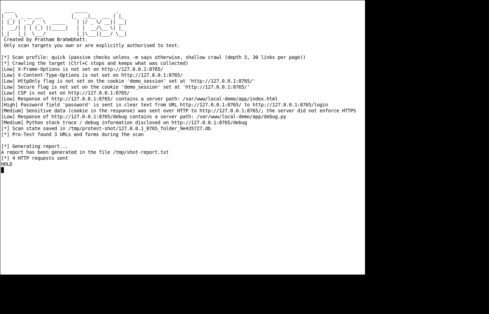
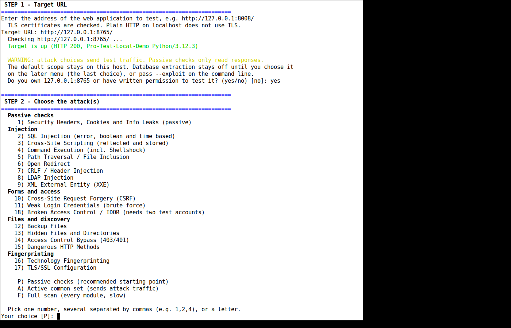
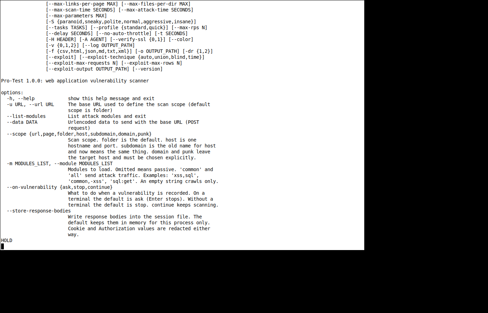

# LOCAL DEMO / EXAMPLE

This directory is a localhost fixture and the reports produced by pointing Pro-Test at it. The fixture is intentionally missing ordinary browser protections. It is not a site to deploy, and it does not implement injection, command execution, or file read.

`server.py` binds `127.0.0.1` only, discards query strings and posted bodies, and never echoes them.

## Run it

After `pipx install` from the repository root (see the top-level README). No virtual environment needs to be activated:

```bash
python examples/local-demo/server.py 8765
```

In another terminal:

```bash
pro-test -u http://127.0.0.1:8765/ -m passive --profile quick --no-database \
  --store-session /tmp/protest-demo-sessions --flush-session \
  --on-vulnerability continue \
  -f txt -o examples/local-demo/output/report.txt
```

Without `--on-vulnerability continue`, a non-interactive shell stops at the first vulnerability and writes a shorter report. The checked-in files used `continue`.

Other formats use the same command with `-f json`, `md`, `html`, `csv`, or `xml` and a matching `-o` file. Stop the server with Ctrl+C. Remove `/tmp/protest-demo-sessions` afterwards. That directory is a session database and is not part of the repository.

The interactive menu was exercised against the same URL with choice `P` (passive), settings `2` (quick crawl), and then `0` to exit. Choice 8 on the later menu (database extraction) was not used. The fixture is plain HTTP, so the default TLS check does not apply to it. `output/help.txt` and `screenshots/help.png` match `pro-test --help`. `screenshots/pause.png` is the stop/continue prompt on the first vulnerability.

## What the run printed

`output/scan-terminal.txt` is the stdout of the text-report command above. It reports 3 resources and 4 HTTP requests. The text report's summary counts are:

| Finding | Count |
|---|---|
| Cleartext Submission of Password | 1 |
| Unencrypted Channels | 1 |
| Clickjacking Protection | 1 |
| MIME Type Confusion | 1 |
| HttpOnly Flag cookie | 1 |
| Secure Flag cookie | 1 |
| Content Security Policy Configuration | 1 |
| Information Disclosure - Full Path | 2 |
| Stack Trace Disclosure | 1 |

Every attack category in that summary is 0. The report files still contain the program's built-in catalogue text for those categories.

## Screenshots

These are xterm windows from the local run, not drawings.







## Files in `output/`

| File | What it is |
|---|---|
| `report.txt`, `report.json`, `report.md`, `report.html`, `report.csv`, `report.xml` | Unedited reports from the command above. Target `http://127.0.0.1:8765/`. |
| `scan-terminal.txt` | Stdout of the text-report run. |
| `help.txt` | `pro-test --help`. The only edit is the default database path: the machine home directory is written as `~`. |
| `list-modules.txt` | `pro-test --list-modules`, unedited. |
| `version.txt` | `pro-test --version` (`Pro-Test 1.0.0`). |

The curl lines inside the reports point at `http://127.0.0.1:8765/` only.
